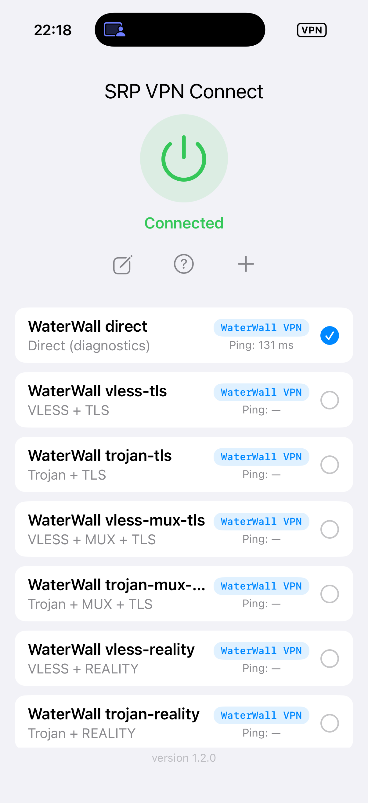
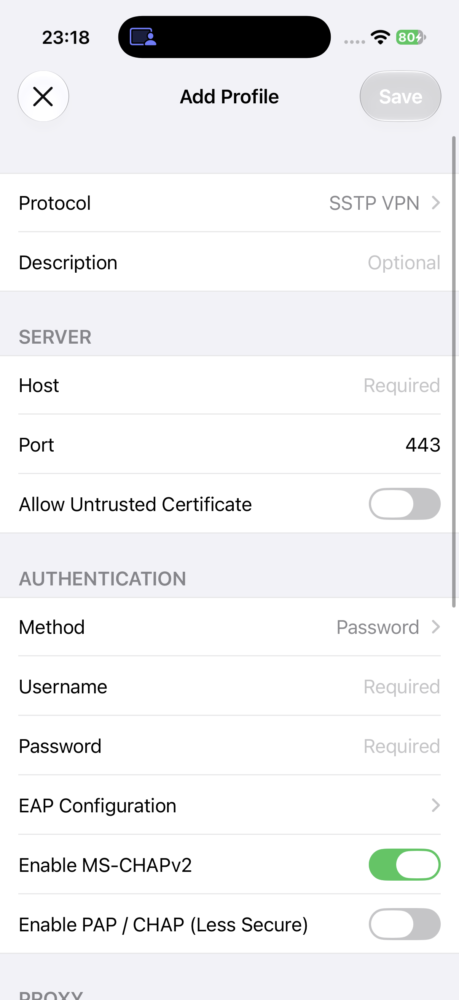
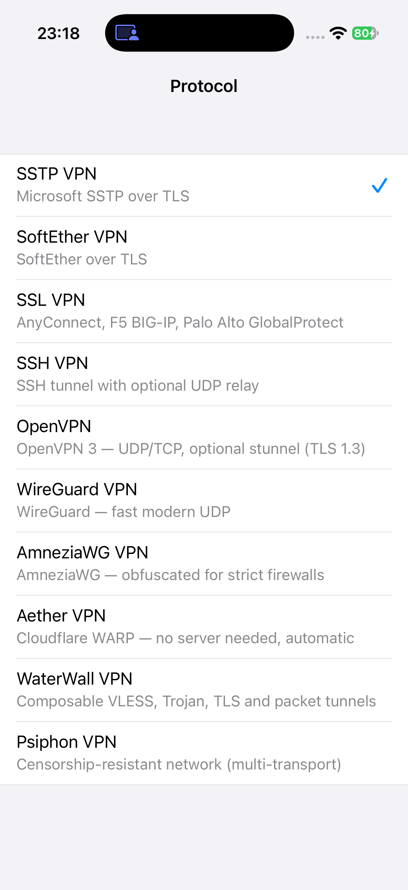

# SRP VPN Connect

SRP VPN Connect is an iPhone and iPad application for learning how VPN clients and packet-tunnel extensions work. It combines an Objective-C profile editor with C, C++, Go, and Rust protocol engines.

**For educational purposes only. This project is not a VPN service.** It does not include servers, accounts, VPN profiles, or subscription credentials. Only connect to servers and networks that you own or are authorized to use. Compatibility and connectivity depend on the server and the network.

[Download the public TestFlight beta](https://testflight.apple.com/join/A1tAaYW4)

## Screenshots

<table>
  <tr>
    <td></td>
    <td></td>
    <td></td>
  </tr>
  <tr>
    <td align="center">Profiles and automatic latency</td>
    <td align="center">Adding a profile</td>
    <td align="center">Protocol selection</td>
  </tr>
</table>

## What the app does

- Creates and edits profiles without bundling a server configuration.
- Runs VPN traffic through an iOS packet-tunnel Network Extension.
- Supports iPhone and iPad layouts, with a fixed connection area and a scrollable profile list.
- Measures HTTPS latency automatically after a profile connects. A result is recorded only for a successful HTTP 204 response; it is not an ICMP ping or a claim that every Internet destination is reachable.
- Stores password and certificate references in the Keychain rather than saving those secrets in the profile defaults.
- Checks TLS certificates and asks before making an explicit untrusted-certificate choice.
- Provides protocol-specific options instead of showing the same unrelated switches for every engine.
- Includes a connection log viewer for troubleshooting.

## Protocols

### SSTP VPN

The native SSTP client supports TLS transport, password authentication, and EAP methods including EAP-MSCHAPv2, PEAP, TTLS, TEAP, and EAP-TLS. Proxy settings, custom SNI, TLS version policies, and optional TLS fragmentation are available where applicable. Client certificates can be imported for certificate authentication.

### SoftEther VPN

The SoftEther client core is written in C and runs inside the extension. Profiles support a Virtual Hub, authentication settings, multiple connections, hostname overrides, and optional UDP acceleration. TLS verification and optional handshake fragmentation are handled separately from the SoftEther session settings.

### SSL VPN (OpenConnect)

This profile uses OpenConnect while retaining the SSL VPN name in the interface. Supported server types are Cisco AnyConnect, F5 BIG-IP, and Palo Alto GlobalProtect. Available options include custom SNI and TLS fragmentation. Exact authentication behavior depends on the gateway.

### SSH VPN

SSH profiles provide an SSH-based tunnel with server and authentication settings, host-key configuration, and an optional UDP relay. UDP relay is disabled by default and requires compatible relay support on the server. It should not be enabled merely because the server accepts SSH connections.

### OpenVPN

The OpenVPN 3 client core supports compatible `.ovpn` profiles, including username/password profiles and certificate-based configurations. An optional stunnel TLS wrapper is available for servers configured for that transport. OpenVPN has many directives; compatibility with a particular profile should be checked against the server rather than assumed.

### WireGuard VPN

WireGuard profiles use wireguard-go. Manual entry and WireGuard configuration import are available for peer keys, interface addresses, allowed IPs, DNS, keepalive, and related settings. No server keys or ready-made peer configurations are included.

### AmneziaWG VPN

AmneziaWG uses the AmneziaWG-go engine with the usual WireGuard profile settings and additional obfuscation parameters. The client exposes junk-packet and header fields used by AmneziaWG. These values must match the server; enabling them does not make an ordinary WireGuard server an AmneziaWG server.

### Aether VPN

Aether can use Cloudflare WARP or a private endpoint. Public WARP profiles do not require a private VPN server. Depending on the selected mode, the app supports MASQUE and WireGuard transports, endpoint scanning, a WARP+ license, Tor modes, and TLS fragmentation for H2. A WARP+ license, private endpoint, or other account credential is not included.

### Psiphon VPN

Psiphon uses the clientlib engine with private encoded server entries and the transports enabled by the server and core. The app does not provide a public/shared server list or a Psiphon server entry. You must supply a valid entry for a server you are authorized to use.

### WaterWall VPN

WaterWall provides a general editor for building compatible client-side chains. Available building blocks include VLESS, VMess, Trojan, SOCKS5, HTTP CONNECT, TLS, Reality, AEAD, QUIC, BGP4, HTTP/WebSocket, MUX, KCP, raw IPv4, and WireGuard. The editor validates combinations and allows supported per-node overrides without requiring a separate preset for every chain. No server installation or account is included.

For connection input, the app places Router after PacketsToConnection. Smart Routing controls whether local/private destinations bypass the tunnel. Fake-IP DNS is enabled by default and can be disabled per profile. Optional GeoIP routing sends Iranian destinations to a direct TCP/UDP connector while other destinations follow the proxy chain. When GeoIP is enabled, Router resolves destination domains as needed for matching; otherwise it leaves them unresolved. BGP4 adds BGP-like stream framing before the selected carrier; it is not BGP routing and does not provide encryption.

The **BGP4 Framing** switch inserts BGP4 between the application and the outer protocol. For example, VLESS, BGP4, TLS and KCP can be combined without treating BGP4 as a replacement for TLS. Profiles saved by older versions that use BGP4 as the outer protocol remain supported.

The [client example](Examples/WaterWall/client.example.json) and [matching server example](Examples/WaterWall/server.example.json) demonstrate that combination with placeholder hostnames, credentials and certificate paths. Replace those placeholders with your own values. The client example is the node configuration consumed by the app; it is not a standalone desktop launcher or a ready-to-use VPN account. For a standalone server, reference `server.example.json` from the `configs` array in a WaterWall core configuration and build with the server nodes enabled. Both peers must use the same protocol order. UDP port 443 must be reachable for the KCP example; TLS runs inside KCP, not as a substitute for it.

The WaterWall configuration screen includes a bundled GeoLite2 Country database. You can replace it by uploading a MaxMind country MMDB file or entering an HTTPS download link. Updates are validated and installed atomically, so a rejected file does not replace the working database. The bundled data is provided by MaxMind; see the attribution in `THIRD_PARTY_NOTICES.md`.

## Build from source

### Requirements

- A recent version of Xcode with iOS SDK support.
- An Apple Silicon Mac for the included native archives and macOS tests.
- Git, CocoaPods, Go, Rust through rustup, CMake 3.25 or newer, and Python 3.
- A physical iPhone or iPad for packet-tunnel testing.
- Your own Apple development team for device signing. No signing identity is stored in this repository.

The first build downloads public upstream sources and Go/Rust modules. Keep the generated archives out of commits.

### 1. Clone the repository

```bash
git clone https://github.com/bigmoveus/SRP-VPN-Connect.git
cd SRP-VPN-Connect
```

### 2. Build the native runtimes

```bash
./Scripts/prepare.sh
```

This builds the Aether Rust runtime, the shared Go runtime for WireGuard, AmneziaWG and Psiphon, and the WaterWall runtime. The smaller required native archives are already included. Individual engine build scripts remain in their respective directories when a full rebuild is needed.

### 3. Install the Xcode dependencies

```bash
pod install
open SRP-VPN-Connect.xcworkspace
```

Open the workspace, not just the `.xcodeproj` file.

### 4. Configure signing

1. Select the `SRP-VPN-Connect` target and open **Signing & Capabilities**.
2. Select your development team.
3. Repeat this for the `SRPTunnel` target.
4. Keep the packet-tunnel Network Extension and shared App Group capabilities enabled.
5. If you change the bundle identifiers or App Group, update them consistently in the two entitlement files and in the app/extension source references. The app and extension must use the same shared group.

Select your iPhone or iPad and choose **Product > Run**. On the first connection, allow iOS to add the VPN configuration when prompted.

### Run the unit tests

```bash
xcodebuild test \
  -workspace SRP-VPN-Connect.xcworkspace \
  -scheme SRP-VPN-ConnectTestsMac \
  -destination 'platform=macOS'
```

The tests do not need a VPN server. Cryptographic test material is generated in memory instead of being loaded from private-key fixtures.

## Install with TestFlight

You do not need Xcode or an App Store Connect account to install the public beta.

1. On your iPhone or iPad, open the Apple App Store.
2. Search for **TestFlight**, or open Apple's official listing: [TestFlight on the App Store](https://apps.apple.com/app/testflight/id899247664).
3. Confirm that the developer is **Apple**, then tap **Get** to install TestFlight.
4. Open TestFlight and accept the terms. Sign in with your Apple Account if asked.
5. On the same device, open the public beta link: [SRP VPN Connect beta](https://testflight.apple.com/join/A1tAaYW4).
6. Tap **View in TestFlight**, then **Accept**, and tap **Install**. If the beta is already installed, use **Update** when a newer build appears.
7. Open **SRP VPN Connect**, add a profile for a server you are authorized to use, and tap the power button. Approve the iOS VPN permission request.
8. For later beta updates, open TestFlight and select SRP VPN Connect. TestFlight builds can expire, so an expired build may require a newer beta.

The public beta and the source repository may not always be on the same revision while another build is being prepared or reviewed. The beta does not include a VPN server or account.

## Repository layout

| Path | Purpose |
| --- | --- |
| `SRP-VPN-Connect/` | Application, profile editor, assets, and connection UI |
| `SRPTunnel/` | Packet-tunnel Network Extension |
| `Core/SRPCore/` | Shared protocol clients and SSTP/EAP code |
| `Parser/` | Profile parsing and VPN manager |
| `Aether/` | Aether build script and integration patches |
| `WireGuard/` | Shared Go bridge and build scripts |
| `SoftEther/` | SoftEther source subset and client bridge |
| `OpenConnect/` | OpenConnect source and build script |
| `OpenVPN/` | OpenVPN 3 source and build script |
| `SSH/` | SSH engine, libssh2, and build scripts |
| `WaterWall/` | WaterWall runtime integration and vendored source |
| `SRP-VPN-ConnectTests/` | Unit tests |
| `Scripts/` | Native dependency preparation |
| `Licenses/` | Additional third-party license texts |

## Contributing

Keep source comments, documentation, commit messages, and pull-request discussions in English. Run the unit tests before submitting a change. Do not add server addresses, profiles, server entries, credentials, private keys, signing files, tokens, or device logs to a commit.

See [THIRD_PARTY_NOTICES.md](THIRD_PARTY_NOTICES.md) for third-party components and license information. Protocol names and trademarks belong to their respective owners; this project is not affiliated with those projects or providers.

**Use this project for education and authorized interoperability testing. It is not a substitute for a security review of your own deployment.**
